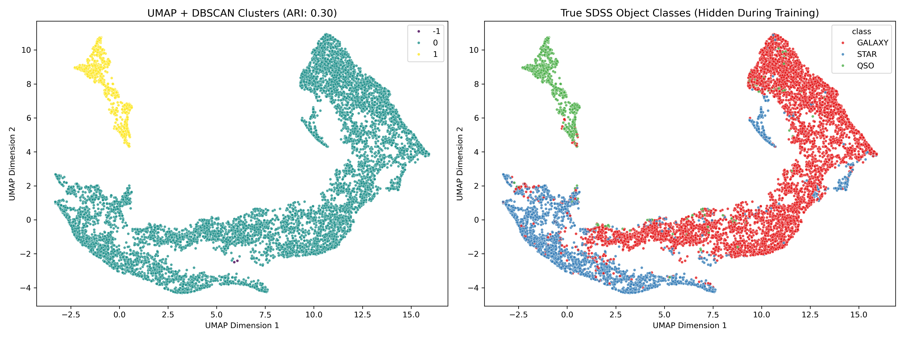

# Unsupervised Manifold Learning & Clustering on SDSS Astronomical Data

## Overview
Applied unsupervised learning to 10,000 photometric and spectroscopic observations from the **Sloan Digital Sky Survey (SDSS)** to discover astrophysical object classes (`STAR`, `GALAXY`, `QSO`) without using ground-truth labels during training.

## Key Findings & Model Iteration

* **Domain Feature Engineering:** Derived distance-invariant astronomical color indices (`u-g`, `g-r`, `r-i`, `i-z`) from raw optical bandpass magnitudes alongside spectroscopic redshift.
* **Manifold Learning & Clustering Progression:**
  1. **5D Gaussian Mixture Model (Baseline):** Achieved `ARI = 0.22` due to outlier sensitivity in raw Euclidean space.
  2. **2D UMAP + GMM:** Improved to `ARI = 0.25`, though elliptical Gaussian assumptions cut across curved photometric filaments.
  3. **2D UMAP + DBSCAN (Final):** Reached `ARI = 0.30` (with **0.1% noise**), cleanly isolating the high-redshift **Quasar (`QSO`)** island while capturing the continuous physical transition bridge between main-sequence **Stars** and low-redshift **Galaxies**.

## Tech Stack
`Python` • `Pandas` • `Scikit-Learn` • `UMAP` • `Seaborn` • `SDSS SkyServer SQL`
